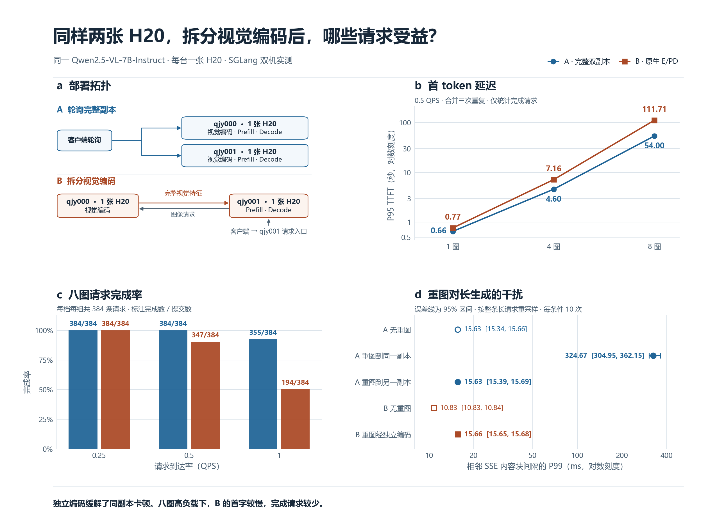

# 同样两张 H20，拆分视觉编码后，哪些请求受益？



- [附图一 · 完整负载矩阵](02-formal-matrix.png)覆盖两组各 27 个正式单元。每单元 128 条请求，固定生成 64 token。小点对应三个重复。汇总首字延迟从成功请求合并计算，汇总完成率使用全部提交请求，汇总成功吞吐为完成数除以各重复的观测时长之和。
- [附图二 · 官方随机多图复现](03-official-multi-image.png)覆盖 0.2、0.4、0.6、0.8 和 1.0 QPS。每档 64 条请求，每请求随机 1–8 图，固定生成 256 token。

A 和 B 均使用同一版 Qwen2.5-VL-7B-Instruct，每台一张 H20。B 的正式结果使用固定编码器和关闭自动探活的回放。TTFT 从客户端发送计到首个非空 SSE 内容块。主图的完成率保留失败和超时分母。

长生成干扰每个条件有 10 个重复。按实际重图到达时刻对齐，无干扰条件按首块后 50 ms 对齐。图上报告相邻 SSE 内容块间隔的 P99；95% 区间在每个条件内对整条长请求重采样 2,000 次。

从汇总数据重新出图需要 Python 和 Matplotlib。若默认字体缺少中文，可通过 `--font` 指定本地字体文件。

```bash
python common/plot_ab_results.py --data figures/ab/ab-figure-data.json --output-dir figures/ab
```
